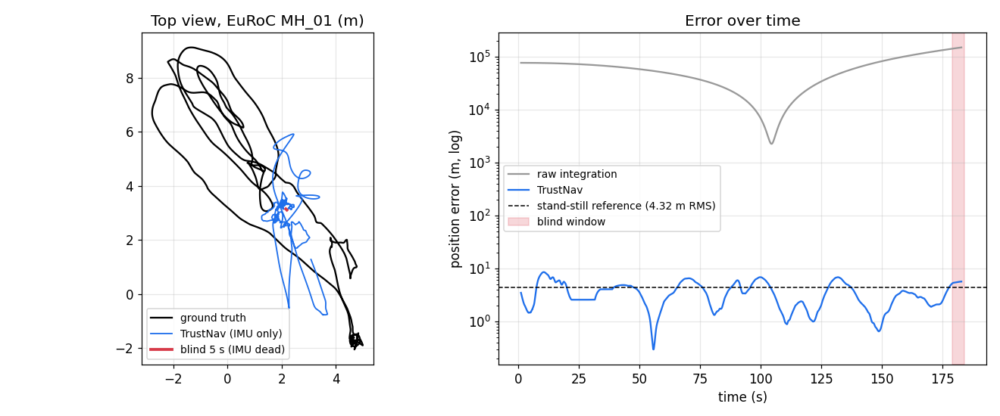
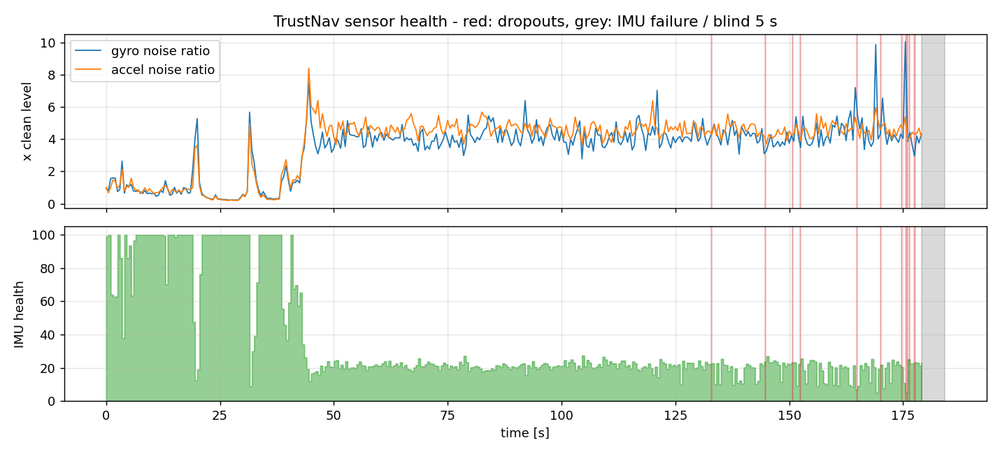

<div align="center">

# TrustNav

**Navigation that keeps going after the sensors start lying.**
From a failing IMU alone, TrustNav recovers the full 6-DoF path, and keeps predicting for 5 s after the IMU dies.

[The problem](#the-problem-in-plain-words) · [What it does](#what-trustnav-does) · [How it works](#how-it-works) · [Under the hood](#under-the-hood) · [Measured results](#measured-results) · [Real-world use](#real-world-use-try-it-on-your-own-phone) · [What isn't done yet](#what-isnt-done-yet) · [Run it](#run-it)

</div>

**▶ Demo video (2:34):** [youtu.be/Md4wv-Sm9wE](https://youtu.be/Md4wv-Sm9wE)

[](https://youtu.be/Md4wv-Sm9wE)


*Real EuRoC MH_01 IMU, degraded with the organisers' own `degrade_imu.py`. Left: the top view of the true path and ours. Right: error over time against raw integration and a stand-still reference.*

Built for the **Samsung PRISM XR Hackathon 2026: Track 03, Path Finder** (trajectory estimation under sensor degradation).
**Team Cipher Guards:** Amberneal Singh, Thapar Institute of Engineering & Technology.

| Submission item | Where |
|---|---|
| Final output | [`estimated_trajectory.txt`](estimated_trajectory.txt) has 35,629 poses for 35,629 input rows and passes 6 of 6 checks ([`validation.json`](validation.json)) |
| Entry point | [`src/main.py`](src/main.py), standard-library Python 3 with nothing to install. Run instructions are in [`src/README.md`](src/README.md) |
| Run metadata | [`metadata.json`](metadata.json) |
| Presentation | [`presentation/`](presentation/) (.pptx and .pdf) |
| Demo video (2:34) | [▶ Watch on YouTube](https://youtu.be/Md4wv-Sm9wE) · copy in the repo: [`docs/TrustNav_demo.mp4`](docs/TrustNav_demo.mp4) |
| Live console | [TrustNav Mission Console](https://am-berneal.github.io/TrustNav-GPS-Denied-Navigation/dashboard/TrustNav-Mission-Console.html) |

---

## The problem, in plain words

Picture an aircraft flying through waypoints with no GPS. The only thing it knows about its own motion comes from an IMU, which is a small sensor that measures turning and acceleration.

Then someone starts jamming it. The readings get noisier and the offsets drift. Some samples vanish, some get stuck, and some come back twice. Finally the sensor dies, and the aircraft still has to reach its target 5 s later.

The textbook approach is to add up the accelerations twice. That turns every small error into a huge one: on this flight, plain integration ends up **68 km** away from a path that never leaves a 12 m room.

## What TrustNav does

| | |
|---|---|
| **1. It checks every sample** | It throws out missing, zeroed, stuck, duplicated and impossible readings before they reach the maths. They still get a pose, because the rules ask for one pose per input row. |
| **2. It decides how much to trust each channel** | It compares each gyro and accelerometer axis against its own clean start. As the noise grows, that channel counts for less. |
| **3. It keeps the attitude honest** | It uses gravity as a reference to keep the aircraft level, and it learns the gyro's drift as it flies. |
| **4. It keeps the position physical** | Speeds fade unless something keeps them up, and the aircraft stays in its workspace and below 3 m/s. Rotor drag tells it how fast it is going. |
| **5. It flies through the gaps and the blind 5 s** | It coasts on that motion model, with speed and turn rate fading out. |
| **6. It shows its work** | A health monitor writes an event log, per-pose confidence and a timeline. A validator checks the output against the rules and stamps it with SHA-256 hashes. |

## Why this isn't "integrate and hope"

An IMU on its own can't see where it is, only how it moves. So TrustNav does not claim to have the map. It uses **prior knowledge of how a drone flies indoors** to keep the estimate inside physics, and it is honest about what that buys: it is clearly better than standing still, and **thousands of times better** than raw integration.

## Built for the rules, checked against the rules

Every rule in the Track 03 FAQ and slides is something the code checks, not something we read and hoped to meet:

| Rule | How TrustNav meets it | Checked by |
|---|---|---|
| Exactly one pose per input IMU row, with nothing appended | Every timestamped row gets a pose. Invalid rows, the blind window and duplicates are included. | `FRAME_DENSITY_SYNC`: 35,629 in and 35,629 out, 0 mismatches |
| Input ns, output seconds | The timestamp is copied exactly: integer ns becomes `s.nnnnnnnnn`, with no float rounding | Same check, compared at the nanosecond |
| Blind window rows are in the input with invalid values | Zeroed, NaN or stuck rows are detected and dead-reckoned | Health monitor reports `IMU_FAILURE` at 179.1 s |
| Dropouts are missing rows | The gap is bridged inside the filter, and no extra poses are written | Validator, plus dropout scoring |
| Python `main.py` | `src/main.py`, standard library only | Docker image with no dependencies |
| ≤ 8 MB at the algorithm level | **0.91 MB** peak heap, from `tracemalloc` | `tools/measure.py` |
| ≤ 20 ms per 1 s of IMU, single thread | **8.1 ms** per IMU second | `tools/measure.py` |
| Unit quaternions, monotonic time | Every pose | `SO3_NORM` and `MONOTONIC_CLOCK` |

The organisers' `degrade_imu.py` documents the column order as `t, accel, gyro`. Raw EuRoC files are `t, gyro, accel`. TrustNav works out the order by itself from which triple reads about 1 g. It also detects the timestamp unit (s, ms, µs or ns) and the accel unit (m/s² or g).

## How it works

```
degraded imu0/data.csv
   │
   ├─ sniff layout ──► column order · timestamp unit · accel unit       (first 2,000 rows, bounded memory)
   │
   ├─ row gate ──────► valid │ NaN │ zero │ stuck │ duplicate │ impossible
   │                     │
   │                     ▼
   │   start-up calibration (quietest 1 s): gravity direction, g, gyro bias, noise floor
   │                     │
   │   per-channel trust + 8σ spike gate
   │                     │
   │   quaternion strapdown + trust-weighted tilt correction + gyro-bias integral
   │                     │
   │   motion prior: velocity fade · workspace spring · 3 m/s bound · ZUPT · rotor-drag aiding
   │                     │
   │   guardrail: position step ≤ vmax·dt
   │                     │
   └──────────────► one TUM pose per input row ──► validator (6 checks, SHA-256) ──► health monitor + console
```

## Under the hood

| Piece | Job | Why it matters |
|---|---|---|
| Format sniffer | Works out the column order and units from the data itself | One script copes with the EuRoC layout, the documented layout, and s/ms/µs/ns timestamps |
| Row gate | Marks unusable rows but never skips them | One pose per row stays guaranteed, even through the blind window |
| Quiet-window calibration | Finds gravity, g and gyro bias from the calmest second | Handles the brief's "unknown gravity alignment" |
| Per-channel trust and spike gate | Down-weights a channel as its noise grows, and rejects outliers | Jamming gets worse over time, so trust must fall with it |
| Mahony complementary filter | Keeps tilt error at **4.9°** RMS | Correct tilt is what keeps gravity from leaking into position |
| Motion prior | Velocity fades (τ 0.5 s), a workspace spring pulls back (τ 1.5 s), speed is capped at 3 m/s, ZUPT at rest | Turns an exploding double integral into a bounded estimate |
| Rotor-drag aiding | Sideways specific force = −k·v, with k = 0.17 s⁻¹ | A real speed signal from the IMU itself (Leishman et al., 2014) |
| Blind-window model | Coasts with fading speed and yaw rate, tilt held level | The 5 s after failure is 20 % of the score |
| Guardrail | Limits each position step to vmax·dt | Was found by our own validator, and it improved every run |
| Health monitor (`tools/health.py`) | Event log, per-pose confidence, health timeline | Tells an operator *when* to stop trusting the path |
| Validator (`tools/validate_output.py`) | 6 rule checks plus SHA-256 of source, input and output | Nothing ships without passing; anyone can reproduce it bit for bit |
| Mission Console (`dashboard/`) | Three tabs: Mission, Stress Test, Trust & Verify | Built from the real output files, with no made-up numbers |


*The health monitor on the official-degraded input. It reports 853 single-frame drops, 11 longer gaps, 487 stuck rows, 49 duplicated rows, 30 spikes, and the IMU failure at 179.1 s. For comparison, the organiser script's own log reports 38 spikes, 525 stuck samples and 49 duplicates.*

## Decisions worth defending

| Decision | Why |
|---|---|
| Never skip a row | The rules punish dropped or misaligned rows harder than a bad pose. An invalid row still gets the best pose we can give it. |
| Copy timestamps as strings | A double can't hold a 19-digit ns value exactly, so we never round-trip through floats. |
| Detect the layout, don't assume it | The organiser script and the slides describe different column orders. Guessing wrong would mean treating gravity as rotation. |
| A strong motion prior, stated openly | IMU-only position isn't observable, so a prior is the only thing that beats drift. We report the stand-still baseline next to our numbers. |
| Python, not C++ | The FAQ asks for Python `main.py`. Our earlier C++ port is kept in `extras/cpp_port/` and is not submitted. |
| Offline but streaming | One pass with bounded buffers, so memory stays under 1 MB whatever the length of the flight. |

## Measured results

**With the organisers' `degrade_imu.py`** (seed 42, real EuRoC MH_01 IMU, scored against EuRoC ground truth with Umeyama SE(3) alignment, as evo does):

| Run | Rows in / poses out | Checks | ATE | Checkpoints | Blind 5 s | RPE (1 s) |
|---|---|---|---|---|---|---|
| Documented order (t, accel, gyro), level 1.0 | 35,629 / 35,629 | 6/6 | **3.96 m** | 2.08 m | 5.49 m | 0.69 m |
| Raw EuRoC order (t, gyro, accel), level 1.0 | 35,629 / 35,629 | 6/6 | 4.03 m | 2.30 m | 5.64 m | 0.69 m |
| Level 0.5 | 36,281 / 36,281 | 6/6 | 3.95 m | 2.10 m | 5.65 m | 0.68 m |
| Level 2.0 | 34,167 / 34,167 | 6/6 | 4.00 m | 2.04 m | 5.84 m | 0.73 m |
| Level 1.0, gamma 1.0 | 35,121 / 35,121 | 6/6 | 3.98 m | 2.11 m | 5.37 m | 0.70 m |

Doubling the degradation level moves the ATE by only 5 cm.

| Reference on the same input | ATE |
|---|---|
| Raw integration | 68,362 m |
| Standing still at the best possible point (zero information) | 4.32 m |
| **TrustNav** | **3.96 m** |

**With our harsher replica** (`tools/degrade.py`: noise up to ×6 and two full 2 s dropouts; 3 seeds): the ATE is 3.88, 3.77 and 3.81 m, checkpoints 1.95, 1.77 and 1.81 m, and RPE 0.73 to 0.77 m. Light (×3) and heavy (×10) jamming give the same ATE to within 1 cm. The full table is in `stress_results/stress_table.md`.

**Efficiency:** the peak heap is 0.91 MB against a limit of 8 MB. Runtime is 8.1 ms per IMU second against a limit of 20 ms, on one thread. The Python interpreter's own process memory is about 8.7 MB before our code runs. The FAQ says the limit applies at the algorithm level, which is the figure we report.

## Real-world use: try it on your own phone

Every phone has the same kind of sensor TrustNav reads: a MEMS accelerometer and gyroscope. So anyone can run a real-world version of Track 03's checkpoints, with the organisers' jamming applied on top, in about 15 minutes:

1. Record with **Sensor Logger** (free on Android and iOS) or **phyphox**. Turn on the accelerometer, gyroscope and gravity sensors.
2. Mark a rectangle of about 4 × 3 m on a tiled floor; the tiles give the distances. Hold the phone flat on a book, like a drone body, and walk 3 laps. **Stand still for 3 s at every corner.** The corners are the checkpoints.
3. Write the measured corners into a file like [`tools/field_waypoints_example.json`](tools/field_waypoints_example.json), then run:

```bash
python tools/field_run.py recording.zip my_route.json field_runs/my_walk
```

`field_run.py` does the rest:
- converts the phone export to EuRoC format (`tools/phone_to_euroc.py`)
- jams it with the organisers' `degrade_imu.py`
- runs TrustNav on both the clean and the jammed IMU, plus raw integration for contrast
- checks one pose per row
- finds the corner pauses in the IMU itself, and scores each run against the corners you measured (`tools/field_test.py`)

The output is a table and a top-view plot. The whole chain has been tested end to end, including zipped exports, columns in z/y/x order, accel in g and 100 Hz logging.

**Where this kind of navigation matters:** inspection drones inside tunnels, bridges, ship hulls, mines and warehouses, where GPS never reaches. Also flights through smoke, and anywhere a jammer is active. In each case the IMU is the one sensor that cannot be cut off from outside, and TrustNav keeps it useful as it degrades.

## What isn't done yet

We'd rather say this than have you find it.

- **Position is only modestly better than standing still.** We are 8 % better on ATE. Attitude, short-term motion and robustness are the strong parts. Room-scale position from an IMU alone is fundamentally weak.
- **The blind 5 s is our weakest tier.** The error there is about 5.5 m, while checkpoints are about 2.1 m.
- **No field trial with our own hardware yet.** The phone field-test kit above is ready and tested, but we haven't run a recorded walk through it before the deadline. A walking person also isn't a drone: the motion model was tuned for drones, so we expect walking results to be weaker.
- **Only one real flight was tuned on (MH_01).** The motion prior (workspace size, 3 m/s cap) fits EuRoC drones. TUM-VI is handheld and has larger spaces, and we haven't tested it.
- **The health monitor's noise ratio also rises when the drone starts moving**, not only under jamming. It flags "noise rising" at take-off as well.
- **No non-causal smoothing yet.** The FAQ allows it, and a backward pass could improve the checkpoints.
- **The hidden ground truth is not ours.** Our scores use our own evo-equivalent scorer (`tools/evaluate.py`) against public EuRoC ground truth.

## Run it

```bash
# the submission: Python 3, nothing to install
python src/main.py path/to/imu0/data.csv estimated_trajectory.txt

# check the output against the rules (6 checks + SHA-256 fingerprints)
python tools/validate_output.py estimated_trajectory.txt path/to/imu0/data.csv

# health monitor: event log, per-pose confidence, timeline
python tools/health.py path/to/imu0/data.csv health_out estimated_trajectory.txt

# rebuild the Mission Console from the real files
python tools/build_console.py
```

Docker: `docker build -t trustnav . && docker run --rm -v $PWD:/data trustnav /data/imu0/data.csv /data/estimated_trajectory.txt`

**Reproduce our scores** (needs numpy, pandas and scipy for the tools only, not for the solver):

1. Get EuRoC MH_01_easy. It's the [Kaggle ROS bag](https://www.kaggle.com/datasets/chunai/euroc-mh-01-easy-ros-bag-dataset); convert it with `pip install rosbags && python tools/bag_to_euroc.py MH_01_easy.bag MH_01_easy`. Ground truth is in the Kaggle dataset `drmainak/uzh-fpv-and-euroc`, at `MH_01_easy/mav0/state_groundtruth_estimate0/data.csv`.
2. Official degradation: put the organisers' `degrade_imu.py` in `tools/official/`, then run `python tools/official_check.py MH_01_easy`. The result goes to `real_runs/official_table.md`.
3. Our harsher replica: `bash tools/run_real.sh MH_01_easy 1` and `python tools/stress_test.py MH_01_easy`.

`tools/evaluate.py` gives the same ATE as `evo_ape tum gt.txt est.txt -a`.

## Repo layout

```
src/main.py              the solver (submission entry point)
src/README.md            how to run it
estimated_trajectory.txt final output (official-degraded MH_01)
metadata.json            runtime, memory, measured results
validation.json          6 rule checks + SHA-256 fingerprints
tools/                   validator, health monitor, scorer, degraders, stress test, console builder, phone field-test kit
real_runs/               inputs, outputs and scores we measured on
dashboard/               TrustNav Mission Console (static HTML)
presentation/            slides (.pptx, .pdf)
docs/                    README figures and the demo video (TrustNav_demo.mp4)
extras/cpp_port/         older C++17 port (not the submission)
```

## Licence

Copyright (c) 2026 Amberneal Singh (Team Cipher Guards). All rights reserved.

This source is public so that the Samsung PRISM XR Hackathon's judges and organisers can review and re-run it, as the event's rules require. It isn't open source. No licence to reuse it is granted beyond the rights given to the organisers in the hackathon's Official Rules. The EuRoC MAV dataset and the open-source libraries used by the tools keep their own licences.
